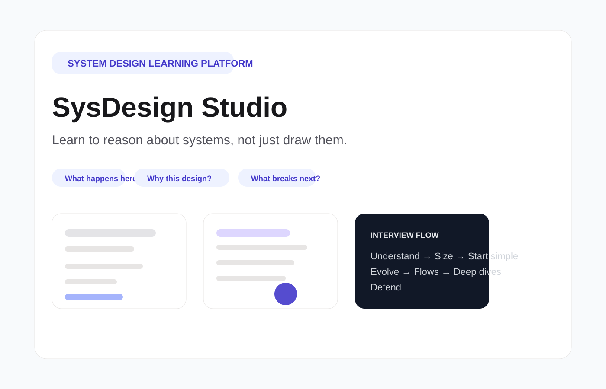

# SysDesign Studio

> Learn to reason about systems, not just draw them.

A polished learning app for system design interviews. It helps engineers reason through architecture decisions, trade-offs, bottlenecks, and failure modes instead of memorizing buzzwords.

Built with Next.js, TypeScript, Tailwind CSS, and a content-driven problem model so each design lesson is easy to extend without touching the UI.

## Author

This project is created and maintained by Santosh Goteti.

## About

SysDesign Studio is built for engineers who want to strengthen the mental models behind real systems:

- why a component exists in the first place
- what problem it solves under realistic load
- which alternatives were considered and rejected
- what breaks first as scale increases
- how the design evolves from a simple starting point to a resilient system

This repository turns those ideas into a guided interview-style learning journey.

## Why this project?

System design interviews are not about drawing fancy diagrams — they are about explaining:

- why a component exists
- what problem it solves
- what alternative options were considered
- what breaks under load
- how the design evolves over time

SysDesign Studio turns those ideas into guided design journeys.

## Features

- Immersive home page: a self-playing live architecture (URL Shortener grows from one server to a global CDN, a cache node fails and recovers) with request packets, synced captions and real numbers, plus animated stats and a "Continue" shortcut for returning readers. Pure SVG + CSS (no extra libraries), paused off-screen and still when "reduce motion" is on.
- 7-stage interview learning flow
  - Understand
  - Size
  - Start simple
  - Evolve
  - Flows
  - Deep dives
  - Defend
- Local profile with Netflix-style "continue where you left off": progress per problem, an automatic recap, your notes, streak and interview countdown (no login; light/dark toggle on the profile page). Running locally with `npm run dev`, progress is saved to `data/profile.json`. Any production build/deployment keeps it in each visitor's browser instead (`localStorage`), with Export/Import to back it up or move devices. Set `NEXT_PUBLIC_PROGRESS_STORAGE=file` or `browser` to override.
- Per-problem quiz (URL Shortener so far): 5 reasoning questions per attempt (what breaks, why an option lost, what a number implies, sync call or queue). The core quiz unlocks after Stage 5 (Flows) and an "Interviewer round" after Stage 7. Each new attempt is at least 35% new, missed questions come back, options are shuffled, and every answer links back to the stage, step or flow to reread.
- Every problem includes a plain-language overview and a "sync API or queue?" guide for each interaction
- Visual architecture diagrams with highlighted changes
- Flow-based reasoning with write, read, and failure paths
- Content-first architecture so new problems can be added without UI changes
- Designed for senior engineers, platform engineers, backend developers, and interview prep

## Problems

Ready (each with 6 evolution steps, 7–9 animated flows including failure drills, and 3 deep dives):

| Problem | Difficulty | Focus |
|---|---|---|
| URL Shortener | Medium | Read-heavy key-value system; ID generation without coordination |
| Rate Limiter | Medium | Token buckets, distributed counters, fairness under contention |
| Phone Directory | Medium | Caller lookup at massive scale |
| Web Crawler | Hard | Politeness, dedupe, a frontier that isn't a plain queue |
| Video Streaming | Hard | Upload pipeline, chunk-parallel transcoding, adaptive bitrate, CDN |
| Chat App | Hard | Persistent connections, per-conversation ordering, offline delivery, group fan-out |
| News Feed | Hard | Fan-out on write vs read, the celebrity problem, hydration, ranking |

12 more are listed as "planned" on the home page (see Roadmap).

## Screenshot



## Tech stack

- Next.js 15
- React 19
- TypeScript
- Tailwind CSS
- @xyflow/react
- Framer Motion
- Mermaid

## Project structure

```bash
src/
  app/
    page.tsx                  # home: immersive hero + problem list
    about/page.tsx            # about the project and author
    profile/page.tsx          # Netflix-style profile and progress
    api/profile/route.ts      # local file storage for progress (dev only; 404 in production)
    problems/[slug]/page.tsx  # the 7-stage journey for one problem
  components/
    home/                     # Hero, LiveArchitecture, ContinueChip
    journey/                  # JourneyViewer + one component per stage, notes panel
    profile/                  # profile page pieces, theme toggle, export/import
    quiz/                     # quiz dialog
    diagram/                  # React Flow architecture diagram
    ui/
  content/
    registry.ts               # ready + planned problems
    types.ts                  # the Problem schema
    problems/<slug>/index.ts  # one file per problem (pure data)
  lib/
    diagram.ts                # replays evolution deltas
    mermaid.ts                # sequence diagrams from flows
    progress/                 # profile/progress types, pure logic, storage, client store
    quiz/                     # unlock rules and the question picker (pure)
docs/superpowers/             # design specs and implementation plans
```

## Quick start

### 1) Clone the repository

```bash
git clone https://github.com/Santoshrt999/sysDesign-studio.git
cd sysDesign-studio
```

### 2) Install dependencies

```bash
npm install
```

### 3) Run the app locally

```bash
npm run dev
```

(Uses Turbopack. In development each page compiles the first time you open it, so the first click on a problem can take several seconds; later visits are fast. `npm run dev:webpack` uses the older bundler. A production build has no such delay.)

Then open:

```text
http://localhost:3000
```

### 4) Build for production

```bash
npm run build
```

### 5) Run type checking

```bash
npm run typecheck
```

## GitHub setup and push

If this repo is not already initialized in your local folder, run:

```bash
git init
git branch -M main
git remote add origin https://github.com/Santoshrt999/sysDesign-studio.git
git add .
git commit -m "Initial commit"
git push -u origin main
```

If the remote already exists, update it instead:

```bash
git remote set-url origin https://github.com/Santoshrt999/sysDesign-studio.git
```

If you prefer SSH instead of HTTPS:

```bash
git remote set-url origin git@github.com:Santoshrt999/sysDesign-studio.git
```

## Adding a new problem

This project is intentionally content-driven. To add a design problem:

1. Create a new folder under `src/content/problems/<slug>/`
2. Export a `Problem` object from a file like `index.ts`
3. Register it in `src/content/registry.ts`

No UI changes are required for new problems.

## Roadmap / pending work

**Review**
- [ ] Teaching-quality review of all 7 problems by the author
- [ ] Visual check of the Video Streaming, Chat App and News Feed diagrams in the browser
- [ ] Phone-width check of the home hero, profile page and problem pages; check the hero with "reduce motion" on

**Content**
- [ ] 12 planned problems: Notification System, Unique ID Generator, Distributed KV Store, Search Autocomplete, Ride Sharing, File Storage & Sync, Payment System, Ticket Booking, Leaderboard, Distributed Message Queue, Stock Exchange, Proximity Service
- [ ] Quiz pools for the other 6 problems (about 15 core + 8 interviewer questions each); URL Shortener's needs the author's review first
- [ ] Framework page, Building Blocks, Decision Trees, Scaling Cheat Sheet

**Product**
- [ ] Practice mode: reveal one stage at a time, drag-and-drop canvas, self-review checklist
- [ ] Problem cards on the home page resume in-progress problems directly
- [ ] Multiple profiles on one machine (local file mode); a hosted site already gives each browser its own
- [ ] Optional sign-in (GitHub/Google) with cloud sync, only if users ask for it

**Engineering & launch**
- [ ] Choose a host (e.g. Vercel) and deploy; progress automatically uses browser storage in production
- [ ] Turn the content validation script (flow hops follow edges, no overlapping nodes or crossing edges) into `npm run validate`
- [ ] Decide on React Flow attribution (show it, or get React Flow Pro): a console warning appears today
- [ ] Refresh screenshots and the demo GIF (they predate the hero and profile)

## Release checklist

- [ ] Confirm the main app loads without runtime errors
- [ ] Run `npm run build` successfully
- [ ] Run `npm run typecheck` successfully
- [ ] Verify homepage, problem routes, and diagram rendering are working
- [ ] Check README and project links are accurate
- [ ] Confirm LICENSE matches the intended project ownership
- [ ] Add screenshots or demo assets if sharing publicly
- [ ] Review commit history and final branch state
- [ ] Tag a release version if publishing to a broader audience

## Notes

The app follows a strict teaching structure where each problem evolves from a simple architecture to a production-grade design with explicit trade-offs, failure modes, and mitigation strategies.

## License

This project is licensed under the MIT License.

See the [LICENSE](LICENSE) file for the full license text.

---

Made for engineers who want to get better at system design reasoning.

© 2026 Santosh Goteti
